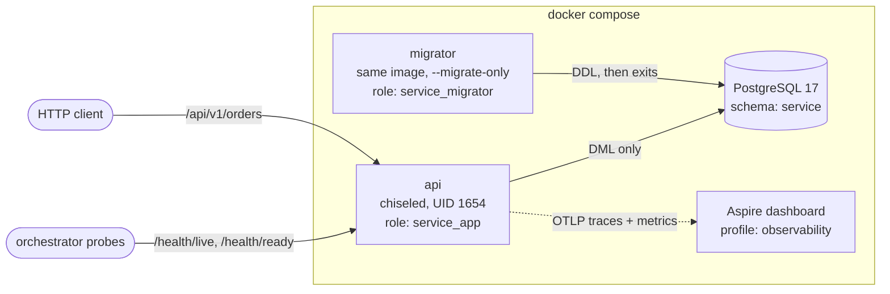

# dotnet-service-template

[](https://github.com/hekimcan206/dotnet-service-template/actions/workflows/ci.yml)
[](https://github.com/hekimcan206/dotnet-service-template/actions/workflows/codeql.yml)
[](https://github.com/hekimcan206/dotnet-service-template/actions/workflows/template.yml)

[](LICENSE)

A .NET 10 service template with production defaults already wired in. You can use it as a
**GitHub template repository** or as a **`dotnet new` template** (`hekim-service`).

## Problem

A new service usually starts with a day or two of setup: logging, health checks, error format,
OpenAPI, Docker, CI. Each service ends up doing these slightly differently, and important parts get
skipped: non-root containers, a least-privilege database account, readiness that actually checks
the database, tests against the real engine. Those gaps tend to surface in production.

## Solution

One repository that builds warning-free, passes tests against real PostgreSQL, runs with
`docker compose up`, and renames itself cleanly to `YourCompany.YourService`. The sample `Orders`
feature is small but not CRUD. It has a state machine, merge rules, money validation and optimistic
concurrency, so every piece of plumbing is exercised by real behaviour.

| Concern | What you get |
|---|---|
| API | Minimal APIs with typed results, built-in validation, RFC 9457 ProblemDetails (stable `code` and `traceId`) |
| Docs | Versioned OpenAPI document `/openapi/v1.json` + [Scalar](https://scalar.com) UI at `/scalar` |
| Health | `/health/live` (process only) and `/health/ready` (database check), JSON bodies, no leaked exception text |
| Data | EF Core 10 + Npgsql, dedicated schema, check constraints, `xmin` optimistic concurrency, write races → `409` |
| Least privilege | `--migrate-only` runs as schema owner; the API runs as a DML-only role (tested) |
| Observability | Serilog compact JSON (with trace/span ids); OpenTelemetry traces + metrics; OTLP when `OTEL_EXPORTER_OTLP_ENDPOINT` is set |
| Container | Multi-stage build, `aspnet:10.0-noble-chiseled`, non-root UID 1654, no shell |
| Tests | xunit.v3 on Microsoft.Testing.Platform, AwesomeAssertions, FsCheck properties, Testcontainers + WebApplicationFactory |
| Build hygiene | Central Package Management, `TreatWarningsAsErrors`, `AnalysisLevel=latest-recommended`, code style enforced in build |
| GitHub | CI (vulnerable-package audit, build, test, coverage summary, image build + non-root check), CodeQL, issue/PR templates |

## Architecture



Inside the service ([ADR 0001](docs/adr/0001-minimal-api-with-feature-folders.md)):

```mermaid
sequenceDiagram
    participant C as Client
    participant E as OrderEndpoints
    participant O as Order aggregate
    participant DB as PostgreSQL
    C->>E: POST /api/v1/orders/{id}/lines
    Note over E: built-in validation → 400 problem
    E->>DB: SELECT order + lines
    E->>O: AddLine(sku, qty, price)
    alt rule violated
        O-->>E: DomainError(code, kind)
        E-->>C: 400 / 409 problem+json {code, traceId}
    else ok
        E->>DB: UPDATE orders ... WHERE xmin = @v; UPSERT line
        alt someone else wrote first
            DB-->>E: 0 rows / unique violation
            E-->>C: 409 concurrency_conflict
        else
            E-->>C: 200 order
        end
    end
```

## Why this design

- **Rules live in the aggregate, not in the endpoints.** `Order` returns `DomainError` values with
  stable codes, so clients branch on `order.not_draft`, not on message text. Exceptions are for bugs only.
  ([ADR 0004](docs/adr/0004-errors-and-api-versioning.md))
- **Two database roles, one image.** The process that serves traffic cannot run `DROP TABLE`. An
  integration test asserts `42501 insufficient_privilege` for that role, using the same init script
  as compose. ([ADR 0002](docs/adr/0002-postgresql-ef-core-least-privilege.md))
- **Liveness stays independent of the database.** A database outage takes instances out of rotation
  (`/health/ready` → 503) but does not restart them, which avoids restart storms. Both behaviours are
  covered by tests.
- **Concurrency is proven, not assumed.** 20 parallel writes go to one order. Every response is
  either `200` or a retryable `409`, and the final quantity equals the number of `200`s.
- **The chiseled image** removes the shell and package manager from the runtime.
  ([ADR 0003](docs/adr/0003-chiseled-non-root-container.md))
- **Telemetry is on by default, and the exporter is opt-in.** The service never logs export errors
  when no collector is configured. ([ADR 0005](docs/adr/0005-observability-testing-and-ci.md))

## Quick start

Requirements: .NET SDK 10.0.400+, Docker.

```bash
docker compose up --build
curl http://localhost:58080/health/ready
# {"status":"Healthy","totalDurationMs":…,"checks":{"database":{"status":"Healthy",…}}}
```

Open <http://localhost:58080/scalar> for the API reference, or try the flow by hand:

```bash
id=$(curl -s -X POST localhost:58080/api/v1/orders -H 'content-type: application/json' \
      -d '{"customerReference":"TABLE-7"}' | jq -r .id)
curl -s -X POST localhost:58080/api/v1/orders/$id/lines -H 'content-type: application/json' \
      -d '{"sku":"LATTE-L","quantity":2,"unitPrice":4.50}'
curl -s -X POST localhost:58080/api/v1/orders/$id/submit
curl -s -X POST localhost:58080/api/v1/orders/$id/submit   # 409 problem+json, code order.not_draft
```

With telemetry: set `OTEL_EXPORTER_OTLP_ENDPOINT=http://aspire-dashboard:18889` (in `.env`), run
`docker compose --profile observability up`, then open <http://localhost:58888>.

Run the tests (Docker must be running for the integration tests):

```bash
dotnet test
```

## Using the template

### Option A: `dotnet new` (renames everything)

```bash
git clone https://github.com/hekimcan206/dotnet-service-template.git
dotnet new install ./dotnet-service-template
dotnet new hekim-service -n Acme.Orders -o acme-orders    # optional: --apiPort 58090 --postgresPort 58442
cd acme-orders && dotnet build && dotnet test
```

The generated solution has projects, namespaces, the meter name, the compose project, the image and
the database renamed (`Acme.Orders.*`, `acme-orders`). It also gets its own README and an empty,
hand-maintained CHANGELOG. The template-only workflow and this README are not copied.

### Option B: GitHub "Use this template"

This creates a new repository with the files as they are. Then rename by instantiating locally, as in
Option A, into the new repository's folder, or keep the `ServiceTemplate` names. After that, replace
`Features/Orders` with your own feature, add a migration, and update the README and CHANGELOG.

## Results (measured)

Measured on this repository at v1.0.0. Environment: Windows 11, Docker Desktop 29.9.1 (WSL2,
7.6 GB RAM for the VM), .NET SDK 10.0.401.

| What | Result |
|---|---|
| `dotnet build` (Release, warnings as errors) | 0 warnings, 0 errors |
| Unit tests (domain + FsCheck, 300 cases per property) | 28 passed (2 properties x 300 generated cases each) |
| Integration tests (Testcontainers PostgreSQL 17 + WebApplicationFactory) | 12 passed |
| Full `dotnet test` wall-clock incl. container start (warm image cache) | 14 s (integration assembly 12.4 s, of which about 7 s is container start-up) |
| Runtime image size (`docker image ls`) | 198 MB on disk, 61.6 MB compressed content |
| Image user | `1654` (non-root `app`), checked again in CI |
| `docker compose up` (images built) → `/health/ready` 200 | 10.4 s from `docker compose up -d` on a fresh volume (init roles, migrate, start) |
| `dotnet new hekim-service -n Acme.Orders` → build + all tests | 0 warnings; 40/40 tests pass in the generated solution |
| Line coverage of hand-written API code (union of both test projects; migrations and source-generated code excluded) | 93.7 % (344 / 367 lines) |

## Limitations and next steps

- No authentication or authorisation. Add JWT bearer or OIDC per service; the template does not guess
  an identity provider.
- No rate limiting, output caching or CORS policy. They depend on the deployment topology.
- No retrying execution strategy. Retries for non-idempotent POSTs need idempotency keys first.
- One API version (`v1`). The route-group pattern shows where `v2` goes; header versioning would
  need `Asp.Versioning`.
- The Aspire dashboard profile is for local use only (unsecured auth mode, bound to loopback).
- Kubernetes manifests and Helm charts are out of scope. The image, probes and migrator job map
  directly onto a Deployment plus a Job.

## Privacy note (KVKK / GDPR)

KVKK is Turkey's Personal Data Protection Law (*Kişisel Verilerin Korunması Kanunu*), similar to the
GDPR. All data in this repository is synthetic. There is no real personal or health data. The sample
stores only an opaque customer reference, and logs do not include request bodies. Services built
from this template must classify any personal data they add and keep it out of logs and traces.

## License

[MIT](LICENSE)
